<p align="center">
  <a href="https://testhooks.vercel.app/">
    
  </a>
</p>

<p align="center">
  <strong>A self-hostable <a href="https://webhook.site">webhook.site</a>. When your handler runs on localhost, your browser tab is the tunnel.</strong><br/>
  Capture, inspect, transform, forward and mock webhooks. One binary with the UI built in.
</p>

<p align="center">
  <a href="https://testhooks.vercel.app/"><strong>Live demo</strong></a> &middot;
  <a href="https://sarathsp06.github.io/testhooks/">Docs</a>
</p>

## Try it

Use the **[live demo](https://testhooks.vercel.app/)**: create an endpoint and point any service at its URL. Nothing to install.

## Run it locally (for testing)

A local install is for trying testhooks out. Services on the internet can't reach `localhost`, so it only receives requests you send from your own machine, for example with `curl`.

```bash
curl -fsSL https://raw.githubusercontent.com/sarathsp06/testhooks/main/install.sh | sh && testhooks
```

Or with Docker:

```bash
docker run --rm -p 8080:8080 ghcr.io/sarathsp06/testhooks
```

Open http://localhost:8080. Data is kept in memory and is gone when it stops.

## Deploy it

To receive real webhooks, run testhooks somewhere the sender can reach, with PostgreSQL:

- **Docker Compose with PostgreSQL:** see [Installation](https://sarathsp06.github.io/testhooks/getting-started/installation/).
- **Vercel:** see [Deploy on Vercel](https://sarathsp06.github.io/testhooks/deployment/vercel/).
- **Before going public:** set `AUTH_TOKEN` and `ALLOWED_ORIGINS`; see [Production](https://sarathsp06.github.io/testhooks/deployment/production/).

## What it does

- **Capture:** every endpoint gets a URL; requests appear in the browser as they arrive.
- **Browser mode:** your open tab forwards each request to `localhost` and sends your app's reply back to the sender, so you can test your handler without ngrok. Nothing to install.
- **Transform:** reshape a request with a few lines of JavaScript, or skip it.
- **Forward and reply:** send requests on to another URL, and script what the sender gets back.
- **Verify signatures:** Standard Webhooks (Svix, Sparrow and others), HMAC and Ed25519.

The [docs](https://sarathsp06.github.io/testhooks/) cover configuration, the API and how each mode works.

## Development

Needs Go 1.26+ and Node 22+.

```bash
make build && ./testhooks   # build the binary with the UI embedded
make dev                    # API on :8080 and Vite with hot reload
make test                   # Go tests
```

See [CONTRIBUTING.md](CONTRIBUTING.md).

## License

[Apache License 2.0](LICENSE)
