<p align="center">
  <a href="https://testhooks.vercel.app/">
    
  </a>
</p>

<p align="center">
  <strong>Webhooks, made for humans and for machines.</strong><br/>
  A small, self-hostable tool to test webhooks, like <a href="https://webhook.site">webhook.site</a>: catch one, change its payload, reply with any status, watch the sender react. One click, or one curl. When your handler runs on localhost, your browser tab is the tunnel. One binary with the UI built in. See <a href="AGENTS.md">AGENTS.md</a> for the principles behind it.
</p>

<p align="center">
  <a href="https://testhooks.vercel.app/"><strong>Live demo</strong></a> &middot;
  <a href="https://sarathsp06.github.io/testhooks/">Docs</a>
</p>


## Try it

Use the **[live demo](https://testhooks.vercel.app/)**: create an endpoint and point any service at its URL. Nothing to install.

## Run it locally (for testing)

A local install is for trying testhooks out. Services on the internet can't reach `localhost`, so it only receives requests you send from your own machine, for example with `curl`.

```bash
curl -fsSL https://raw.githubusercontent.com/sarathsp06/testhooks/main/install.sh | sh && testhooks
```

Or with Docker:

```bash
docker run --rm -p 8080:8080 ghcr.io/sarathsp06/testhooks
```

Open http://localhost:8080. Data is kept in memory and is gone when it stops.

## Deploy it

To receive real webhooks, run testhooks somewhere the sender can reach, with PostgreSQL:

- **Docker Compose with PostgreSQL:** see [Installation](https://sarathsp06.github.io/testhooks/getting-started/installation/).
- **Vercel:** see [Deploy on Vercel](https://sarathsp06.github.io/testhooks/deployment/vercel/).
- **Before going public:** set `AUTH_TOKEN` and `ALLOWED_ORIGINS`; see [Production](https://sarathsp06.github.io/testhooks/deployment/production/).

## What it does

- **Capture:** every endpoint gets a URL; requests appear in the browser as they arrive.
- **Browser mode:** your open tab forwards each request to `localhost` and sends your app's reply back to the sender, so you can test your handler without ngrok. Nothing to install.
- **Transform:** reshape a request with a few lines of JavaScript, or skip it.
- **Forward and reply:** send requests on to another URL, and script what the sender gets back.
- **Verify signatures:** Standard Webhooks (Svix, Sparrow and others), HMAC and Ed25519.
- **Types from real traffic:** copy a request's payload as a TypeScript, Zod, JSON Schema, Go or Pydantic type. The API, CLI and MCP server can also merge the last twenty deliveries of an event into one type, so fields that only some carry come out optional.

The [docs](https://sarathsp06.github.io/testhooks/) cover configuration, the API and how each mode works.

## Made for machines too

Everything above is an API call, and the same calls are packaged for scripts and for AI agents:

- **MCP server:** `testhooks mcp` gives Claude Code, Cursor or any MCP client the same tools you use: create an endpoint, wait for the provider's request (no polling), read it, get a type for it, preview a transform or reply script before saving it, send a test request, replay. [Set it up](https://sarathsp06.github.io/testhooks/guides/mcp/).
- **Command line:** `testhooks endpoints create`, `testhooks requests wait`, `testhooks requests types --lang go`, and the rest. JSON when piped, text in a terminal. [Reference](https://sarathsp06.github.io/testhooks/reference/cli/).
- **A skill that teaches the workflow:** `testhooks skill > .claude/skills/testhooks/SKILL.md`, or read [SKILL.md](skills/testhooks/SKILL.md).
- **The API describes itself** at `/api/openapi.json` on every server, and the docs site has an [`llms.txt`](https://sarathsp06.github.io/testhooks/llms.txt).
- **A token that can only read:** set `READ_TOKEN` for an agent or dashboard that should watch endpoints but never change, delete or send anything.

## Development

Needs Go 1.26+ and Node 22+.

```bash
make build && ./testhooks   # build the binary with the UI embedded
make dev                    # API on :8080 and Vite with hot reload
make test                   # Go tests
```

See [CONTRIBUTING.md](CONTRIBUTING.md).

## License

The code is under the [Apache License 2.0](LICENSE): use it, change it, self-host it, for anything.

The name "Testhooks" and the logo are trademarks and are not covered by the code license. Forks need their own name, and offering a hosted service under the Testhooks name needs permission. See [TRADEMARKS.md](TRADEMARKS.md).
